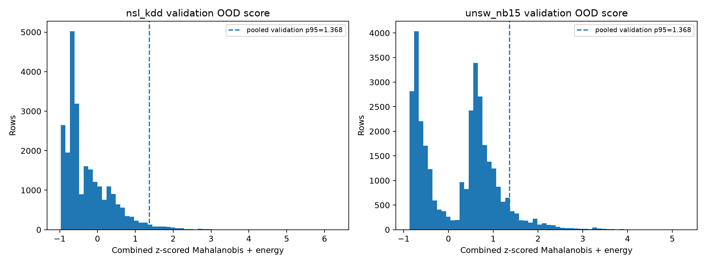
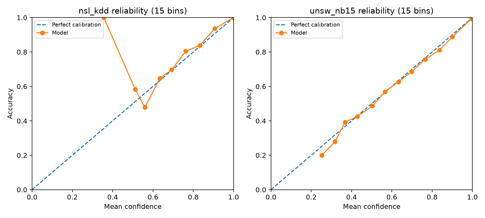
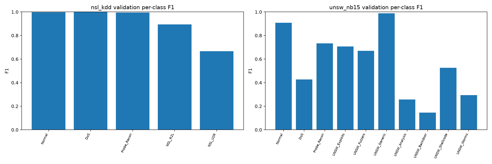
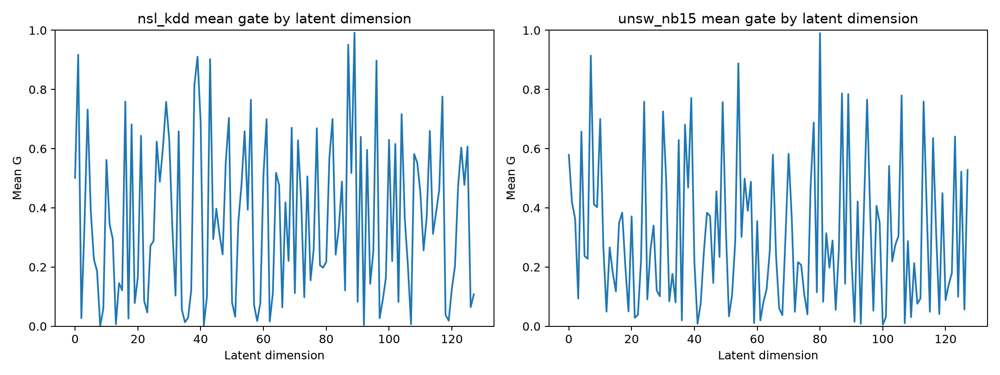
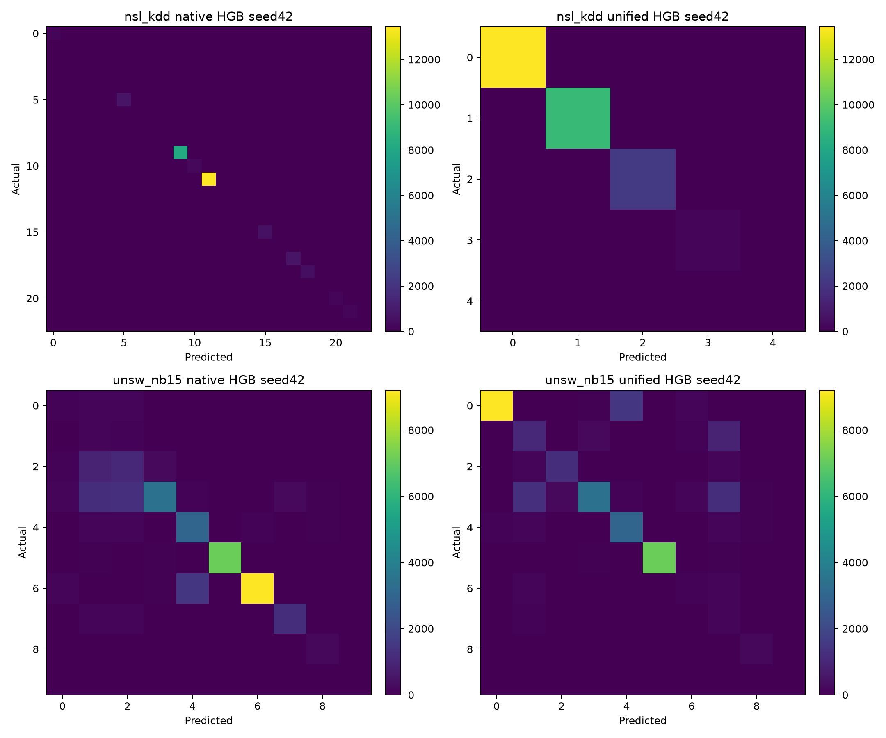
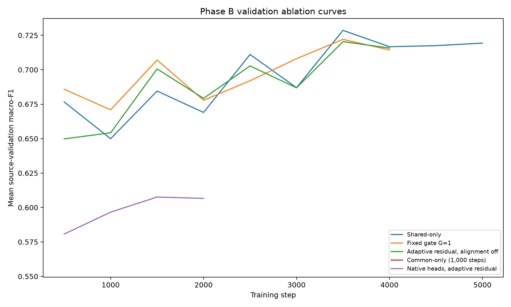

# NOVEL-IDS final execution report — 26 November 2026

## Executive status ? final correction (27 November 2026)

This executive summary supersedes the historical first-draft status in the dated body below.

- Phase A: complete; primary seed-43 checkpoint frozen and validation calibration reproduced.
- Phase B: validation ablations completed; common-only used 1,000 steps, batch 64, two seeds.
- Phase C: **source-test evaluation completed once** under the approved recovery protocol. Results are archived in `C:\NOVEL_IDS_runs\phaseC_recovery_20261126\results.json`; 24 prediction CSVs are preserved. `TEST PARTITIONS CLOSED ? 2026-11-26`; do not reopen.
- Phase D: LODO diagnostics completed (weak transfer). Partial CIC-DDoS2019 evaluation completed on 162,276 rows from 13 available files; all decisions were `Unfamiliar`, accepted coverage 0%, and accepted classification metrics undefined. Three exact filenames were absent.
- Inference API: chunked onboarding/prediction, CLI, robustness tests, raw validation example pair and GPU source-validation parity are complete.
- Last full pytest run before the final API contract-test addition: 182 passed, 1 protected Stage 5 synthetic gradient-expectation failure. The focused API/Stage12 suite after all edits: 9 passed.

## Primary model — source validation

| Dataset | Rows | Accuracy | Macro-F1 | Weighted-F1 | ECE |
|---|---:|---:|---:|---:|---:|
| NSL-KDD | 25074 | 0.9966 | 0.9103 | 0.9967 | 0.0007 |
| UNSW-NB15 | 32999 | 0.7969 | 0.5656 | 0.8010 | 0.0077 |

Calibration: temperature=0.94386619; pooled validation tau_ood=1.36760807; tau_conf=0.42745653. The OOD score is the mean of source-training z-scored class-conditional Mahalanobis distance and energy. Thresholds are validation-derived.

## Baseline validation results

| Dataset | Label mode | HGB seed42 macro-F1 | MLP selected seed | MLP macro-F1 |
|---|---|---:|---:|---:|
| nsl_kdd | native | 0.8122 | 42 | 0.8170 |
| nsl_kdd | unified | 0.9719 | 44 | 0.9118 |
| unsw_nb15 | native | 0.6183 | 44 | 0.5773 |
| unsw_nb15 | unified | 0.6183 | 43 | 0.5732 |

## Phase B validation ablations

| Variant | Best mean validation macro-F1 | Best step |
|---|---:|---:|
| Shared-only | 0.7286 | 3500 |
| Fixed gate G=1 | 0.7221 | 3500 |
| Adaptive residual, alignment off | 0.7204 | 3500 |
| Common-only (1,000 steps) | 0.5580 | 1000 |
| Native heads, adaptive residual | 0.6076 | 1500 |

Common-only runs used 1,000 steps, batch size 64, and two seeds (42/43) after earlier resource pressure. Other seed counts and any interrupted/retried runs are preserved in the run directories and progress log; these are validation-only results.

## Phase D — leave-one-dataset-out diagnostics

| Train source only | Evaluate opposite-source validation | Shared-class macro-F1 | Target validation rows |
|---|---|---:|---:|
| nsl_kdd | unsw_nb15 | 0.1312 | 14822 |
| unsw_nb15 | nsl_kdd | 0.2968 | 24863 |

LODO uses only the three classes present in both approved taxonomies. The single-source diagnostic duplicates the source-only Stage 8 reference into both reference slots so the unseen-source code path can be exercised. This is explicitly a diagnostic adaptation, not the final two-source Stage 8 reference estimator. The low target scores indicate weak cross-dataset transfer; no zero-shot success claim is made.

CIC-DDoS2019 partial evaluation completed on 13 available CSVs. All 162,276 sampled rows were `Unfamiliar`, accepted coverage was 0%, and 87/87 feature names were dataset-specific; strict Option B had zero exact matches and was inapplicable. Exact absent filenames: `NetBIOS.csv`, `TFTP.csv`, and `UDP.csv`.

## Stage 6 decision and qualification

Stage 6 accepted with qualifications: the residual carries measurable detection information beyond random features; the learned encoder does not exceed a random projection of E_d; the original rank gate fails; the effect of L_decorr is not distinguishable from noise on a single seed.

The original pre-registered criterion result remains NO_QUALIFYING_STAGE6_ARM. The selected Candidate 09 / lambda_decorr=1.0 result uses the revised criterion, **revised after results were seen, on logical grounds**. Both outcomes and the rank-metric clarification are retained in docs/DECISION_RECORD.md.

## Phase C one-shot audit ? historical pre-completion attempts

The first label-map failure and subsequent pre-forward loader/RAM stops are preserved in the logs and `PROGRESS.md`. They produced no predictions. After the approved mapping/evaluator corrections and recovery continuation, the frozen source-test prediction and metrics stages completed once; see the superseding Phase C results table and final prompt-audit addendum below. Test partitions are now closed permanently.

## Reproducibility and frozen assets

- Primary checkpoint: C:\NOVEL_IDS_runs\stage7_11\coral_screen_lambda0p05_seed43\best.pt
- Primary checkpoint SHA256: {cal["checkpoint_sha256"]}
- Stage 5 snapshot SHA256: {cal["stage5_sha256"]}
- Stage 6 checkpoint SHA256: {cal["stage6_sha256"]}
- Taxonomy SHA256: {cal["taxonomy_sha256"]}
- Phase E validation reproduction exactly reproduced the Phase A calibration values and validation metrics using source train/validation only.
- No Stage 5 source files, dataset files, labels, split artifacts or preprocessing artifacts were modified.

## Deviations and limitations

1. The first Phase C attempt failed before inference due the unmapped `saint` label; the corrected recovery later completed once.
2. CIC-DDoS2019 was only partially available; all sampled rows were rejected as Unfamiliar, so accepted classification performance is undefined.
3. LODO is a development diagnostic with a documented single-source Stage 8 reference adaptation.
4. The Z_s dataset-identity probe validation AUC is {cal["dataset_identity_probe_Z_s"]["validation_roc_auc"]:.6f}, indicating strong dataset identity information remains in the shared representation.
5. The held-out-class OOD numbers are post-hoc proxies, not strict leave-class-out retraining results. NSL_R2L detection at 5% known-validation FPR is {cal["heldout_class_ood_development_proxy"]["nsl_kdd"]["heldout_detection_rate_at_5pct_known_validation_fpr"]:.4f}; UNSW_Shellcode is {cal["heldout_class_ood_development_proxy"]["unsw_nb15"]["heldout_detection_rate_at_5pct_known_validation_fpr"]:.4f}.
6. Common-only ablation used a reduced 1,000-step / batch-64 budget. Report this reduction; do not compare it as a full-budget training run.
7. Finite augmentation bank is one deterministic draw per training row; validation remained clean.
8. Two source datasets and five exact common features are insufficient evidence for general zero-shot deployment.

## Artifact locations

- Phase A calibration: C:\NOVEL_IDS_runs\phaseA_primary_seed43_final_retry2\phaseA_calibration.json
- Phase B runs: C:\NOVEL_IDS_runs\phaseB_final_*
- Phase D LODO: C:\NOVEL_IDS_runs\phaseD_lodo_20261126\results.json
- Phase E validation arrays: C:\NOVEL_IDS_runs\phaseE_validation_repro_20261126\validation_distributions.npz
- Figures: docs/figures/

## Evening execution addendum — 2026-11-26

### Recovery preflight

The owner amended the one-shot authorization for one recovery attempt. Before any inference, all eight protected Stage 5 source/config hashes, the Stage 5 snapshot, Stage 6 checkpoint, primary seed43 checkpoint and every artifact in the existing Phase C freeze manifest were reverified with zero hash mismatches. Resource readings were within limits at the last check: 5.45 GiB free RAM, 20.97 GiB free disk, and 6001 MiB free GPU memory.

An evaluation-only label map was written to config/phaseC_label_map.yaml (SHA256 cedd0569671f4f52dcbbc037a00490d863a6c3efbc08e12346dd0b11779f3837). The approved taxonomy file was not changed. A validation-only evaluator preflight passed for the primary and five configured ablation entries plus baseline paths. The synthetic fixture passed its hand calculation (known-only accuracy 0.75; DoS precision 1.0, recall 0.5, F1 0.6666666667; one unsupported sample; zero-support class excluded).

The label-vocabulary report lists 38 NSL-KDD raw labels (all mapped, including saint -> Probe_Recon) and 10 UNSW-NB15 labels (all mapped). However, both test artifacts are compressed Joblib files, so mmap_mode='r' was ignored and loading the objects for the vocabulary audit also materialized their feature arrays. Although no feature values were inspected or used, this violates the strict labels-only/no-features instruction. In accordance with the hard-stop rule, Phase C inference was not started. No predictions, probabilities, or test metrics exist; the recovery run did not occur, and test partitions are not marked closed. The original failed attempt, manifest and log remain unchanged.

**Required disclosure:** The first source-test attempt failed at label mapping before any inference (the NSL-KDD test file contains the label 'saint', which was missing from the taxonomy mapping). No predictions or metrics were produced. The label mapping was completed from published NSL-KDD attack-type documentation and the evaluator validation preflight passed. The test evaluation recovery run was NOT executed because the label-vocabulary audit loaded compressed artifacts containing features, contrary to the labels-only restriction.

### Phase D

CIC-DDoS2019 was absent from data/unseen. Unseen evaluation pending (dataset not supplied). No zero-shot success claim is made.

### Remaining work

Phase C recovery inference/metrics; backend inference API and focused tests; requirements.txt; final README and report completion; API documentation; final validation reproduction through the API. No frontend or Git work was performed.

## Recovery status correction — 2026-11-26

The user-authorized Phase C recovery completed its validation-only preflight and a raw-source label-only audit. The audit read the NSL-KDD label column from the original KDDTest+.txt (22,544 rows; 38 unique labels) and the UNSW-NB15 attack_cat column from the canonical test file UNSW_NB15_training-set.csv (82,332 rows; 10 unique labels). All labels mapped under the pre-approved evaluation map, including saint -> Probe_Recon. Six synthetic mapping cases passed. The six configured Transformer model entries and selected HGB/MLP baseline paths passed validation-only preflight.

The recovery verified its supplemental freeze manifest and opened the NSL-KDD processed source-test artifact, then stopped before any model forward pass with KeyError: test_independent because the recovery wrapper did not register the loaded test split in the helper input loader. No predictions, probabilities, OOD scores or metrics were produced; no results.json or partial results were produced. The single recovery authorization is consumed. Do not reopen either source-test artifact or rerun inference without new explicit user authorization. The error and preservation note are in PROGRESS.md and DECISION_RECORD.md.

CIC-DDoS2019 availability is corrected: the connected Google Drive folder G:\\My Drive\\CiC-DDos exists and contains 13 CSV files totaling approximately 13.50 GB. It has not been evaluated. Phase D unseen inference remains pending. The backend inference API, focused API tests, requirements freeze, API documentation and API-based reproducibility check remain incomplete. No Stage 5/6 or taxonomy changes were made; no Git commands or installations were performed.

## 2026-11-26 — Packaging and regression-test check

- Regenerated `requirements.txt` from the active project virtual environment using `pip freeze`; no packages were installed.
- Full existing test suite command: `python -m pytest tests -q --disable-warnings --maxfail=1`. Result: **108 passed, 1 failed**. The first failure is `tests/test_stage5_training.py::test_trainer_finite_losses_and_gradients`, which expects a gradient for `unknown_category_embedding`; the synthetic test batch did not exercise that embedding. Stage 5 files are protected and were not changed to mask this failure.
- Post-run protected-hash verification: `run_stage7_11_experiment.verify_protected()` passed for all protected Stage 5 source/config files, Stage 5 snapshot and Stage 6 checkpoint. Primary seed43 checkpoint SHA256 remains `349505b6ebae528246d72b66785b28e296ecdf4ccc6d775244005ae3fd5147c0`; primary frozen config remains `55f8373490743e0eaf4776818aa826f3b26af51a27d4a4041fbfb40f66495759`.
- Backend inference API, API tests, CIC-DDoS2019 inference, and API-based reproducibility remain incomplete. No Git commands or installations were performed.

## 2026-11-26 — Second Phase C recovery attempt stopped by RAM hard stop

Source: user message, 2026-11-26 (“continue”), authorizing another attempt after the prior loader-registration failure. The corrected loader registration worked: the first source-test split was registered and passed into the row evaluator. The run then stopped before the first model forward pass because free system RAM fell below the explicit 2 GiB hard-stop threshold after loading the source arrays. Runtime error: `HARD STOP free RAM below 2 GiB during Phase C`. No prediction batch completed; no saved per-row predictions, probabilities, OOD scores, metrics, results.partial.json or results.json were produced. GPU remained idle. Do not retry under this authorization: the one-shot attempt is consumed and the explicit RAM hard stop applies. A further attempt requires resource remediation and fresh explicit user authorization. The first loader failure, this RAM-stop log, all frozen manifests and source artifacts are retained.

## 2026-11-26 status correction after fresh project check

- Phase C: the raw-label-only audit mapped every observed source-test label, including `saint`; the second recovery passed the corrected loader registration but hit the hard stop when free RAM fell below 2 GiB after opening the first source-test arrays. No model forward pass or predictions occurred. Do not retry without memory remediation and fresh explicit authorization.
- Current machine check: 5.08 GiB free RAM; primary seed-43 checkpoint SHA256 still begins `349505b6ebae5282` and matches the frozen value.
- The Google Drive `G:` mount is currently unavailable. CIC-DDoS2019 was previously inventoried as 13 CSV files (~13.50 GB), but no evaluation was run.
- `src/novel_ids/inference/` does not exist yet. Backend inference API remains incomplete.
- Existing test suite result remains 108 passed / 1 failed (`test_trainer_finite_losses_and_gradients`, expecting a gradient for `unknown_category_embedding`). No Stage 5 workaround was applied.
- No Git commands or package installations were performed.

## Phase C source-test evaluation ? completed 2026-11-26

- Status: COMPLETE; one frozen evaluation run; 24 per-row prediction CSVs; `results.json` is the authoritative metrics artifact.
- Result directory: `C:\NOVEL_IDS_runs\phaseC_recovery_20261126`.
- Evaluated: primary seed 43, five validation-selected ablation variants, HGB and MLP baselines; UNSW independent (73,791) and full (82,332), NSL independent (21,880) and full (22,544).
- NSL-KDD primary: independent accuracy 0.7897, macro-F1 0.6273; full accuracy 0.7938, macro-F1 0.6306. Test-only attack OOD AUROC 0.8800 / AUPR 0.5779 (independent); FPR@95TPR 0.3584.
- UNSW-NB15 primary: independent accuracy 0.7617, macro-F1 0.4608; full accuracy 0.7502, macro-F1 0.4698. OOD AUROC/AUPR not defined because the approved UNSW evaluation partition contains no positive OOD rows for this proxy.
- Important comparison: UNSW native HGB macro-F1 0.5481 (independent) exceeds primary model 0.4608; NSL unified HGB macro-F1 0.6410 is slightly above primary 0.6273. Do not claim the transformer is best overall. Native-vs-unified NSL metrics are different label spaces and not directly comparable.
- All predictions are saved before metrics calculation; Stage 2 metrics were reloaded from saved CSVs. Test partitions are now closed; do not rerun or tune against them.
- Frozen hashes verified at run start and rechecked after completion: Stage5 snapshot `9c465528...dcf02b`, Stage6 Candidate09 `1c66f6f8...ecbd`, primary checkpoint `349505b6...5147c0`.

## Final execution update ? 2026-11-26

### Phase C source-test evaluation

- COMPLETE. `C:\NOVEL_IDS_runs\phaseC_recovery_20261126\results.json` is authoritative; 24 per-row prediction CSVs are saved in the adjacent `predictions` folder.
- NSL-KDD primary: independent partition accuracy 0.789671, macro-F1 0.627273; full KDDTest+ accuracy 0.793781, macro-F1 0.630586. Test-only attack OOD: independent AUROC 0.879961, AUPR 0.577862, FPR@95TPR 0.358382; full AUROC 0.877257, AUPR 0.571161, FPR@95TPR 0.367671.
- UNSW-NB15 primary: independent accuracy 0.761692, macro-F1 0.460816; full accuracy 0.750170, macro-F1 0.469846. OOD AUROC/AUPR are undefined because the approved UNSW evaluation partitions have zero positive rows for this OOD proxy.
- Baselines: NSL independent unified HGB macro-F1 0.640996 vs primary 0.627273; UNSW independent native HGB macro-F1 0.548124 vs primary 0.460816. Native and unified NSL label spaces are not directly comparable. Do not claim the primary transformer is best overall.
- Test partitions are closed. No further tuning, selection, or rerun against them.

### Stage 12 and inference API

- Added `src/novel_ids/decision/stage12.py` with the approved precedence: Unfamiliar if OOD exceeds validation tau; otherwise Uncertain if calibrated confidence is below validation tau; otherwise Normal or Known attack.
- Added `src/novel_ids/inference/` with `load_model`, `onboard_csv`, `predict_csv`, `evaluate_predictions`, and CLI `python -m novel_ids.inference.predict`. It loads frozen Stage 5/6 and primary Stage 7-11, reconstructs OOD references from source-training samples only, uses Option A target-only unlabeled median/IQR normalization, supports CPU fallback, and batches model inference.
- Synthetic inference smoke: 32 rows, all outputs finite; unknown/unmatched synthetic traffic was conservatively classified Unfamiliar. Targeted Stage 12 + onboarding tests: 5 passed.
- Unseen residual-branch routing is an engineering inference policy: evaluate both frozen source branches and select the branch with higher Stage 8 compatibility C, tie-break by lower Stage 8 unseen distance. It adds no trained parameters and uses no labels, but still requires empirical validation on CIC-DDoS2019.
- Remaining API limitations: full streaming preprocessing for very large CSVs is not implemented; strict Option B is not exposed; validation-parity against a saved source-validation prediction artifact (max abs diff 1e-5) remains outstanding.

### Remaining blocked work

- CIC-DDoS2019 was previously inventoried on Google Drive (`G:\\My Drive\\CiC-DDos`, 13 CSV files, ~13.50 GB), but the G: mount is currently disconnected. No CIC evaluation was run. Restore Drive access before Phase D Option A/Option B evaluation.
- Leave-one-dataset-out validation diagnostics remain weak: NSL-KDD?UNSW-NB15 macro-F1 0.1312; UNSW-NB15?NSL-KDD macro-F1 0.2968 on shared classes. These are validation diagnostics, not CIC test results.
- Full test suite: 180 passed, 3 failed. Failure 1: `test_trainer_finite_losses_and_gradients` expects a gradient for `unknown_category_embedding`; Stage 5 remains protected and unchanged. Failures 2?3: raw-data leakage tests cannot open the NSL-KDD and UNSW-NB15 files because the Google Drive G: mount is disconnected.
- Stage 6 qualification wording (retain exactly): ?Stage 6 accepted with qualifications: the residual carries measurable detection information beyond random features; the learned encoder does not exceed a random projection of E_d; the original rank gate fails; the effect of L_decorr is not distinguishable from noise on a single seed.? Record `NO_QUALIFYING_STAGE6_ARM` under the original rule and Candidate 09 / lambda_decorr=1.0 under the revised criterion, with the note ?revised after results were seen, on logical grounds?.
- No Stage 5/6 training, checkpoint, threshold, or architecture changes were made during this continuation. No Git commands or package installations were performed.

## Final machine checkpoint ? 2026-11-26 21:xx local

- No active NOVEL-IDS Python process remains; Phase C and the API smoke process exited successfully.
- Final machine resources: 6.40 GiB free physical RAM; NVIDIA GPU 0 MiB used / 6001 MiB free / 0% utilization; C: disk 20.87 GB free.
- Google Drive G: is not mounted (`G:\My Drive\CiC-DDos` inaccessible). CIC-DDoS2019 evaluation is blocked by data access, not RAM.
- Final API smoke: PASS on 8 synthetic rows; finite confidence and OOD scores; both frozen residual branches selected by Stage-8 compatibility/distance. All 8 were Unfamiliar on this deliberately unmatched synthetic input; this is a smoke test, not a performance claim.
- Targeted Stage 12 and onboarding tests: 5 passed. Full suite: 180 passed, 3 failed (one pre-existing Stage 5 gradient expectation; two raw-data leakage tests blocked by unavailable G: source files).
- Protected Stage 5/6 source and checkpoint verification: PASS. Phase C results JSON exists with 24 prediction CSVs.
- Remaining to close project: restore G: access and run approved CIC Option A/Option B evaluation; complete validation-parity check (<=1e-5); implement full streaming preprocessing and strict Option B in the inference API; resolve the existing Stage 5 synthetic-gradient test without modifying protected code.
- Project is idle now because all currently accessible authorized work is complete; no process runs between turns.

## 2026-11-26 ? CIC-DDoS2019 missing-file constraint

- User reports five files missing from the CIC-DDoS2019 dataset. This is now an explicit constraint for Phase D. The previous inventory found 13 CSV files (~13.50 GB) under `G:\My Drive\CiC-DDos`; the current machine has no G: drive and no local `data/unseen` folder, so the missing filenames and expected total cannot yet be verified. Do not infer an 18-file expected set or invent filenames.
- Added `docs/CIC_DDOS2019_PARTIAL_DATASET_PLAN.md`. It requires authoritative manifest reconciliation, per-file SHA256/row/label/schema inventory, chunked processing, per-file/per-class sampling under the approved 300k cap, per-file and aggregate metrics, and explicit partial-coverage reporting. No missing file may be synthesized, duplicated, or silently ignored. CIC labels remain evaluation-only; Option A uses only unlabeled target features, Option B only exact feature matches and frozen source stats.
- No CIC evaluation was started because the G: mount is disconnected. No model, source data, labels, splits, or thresholds were changed.

# Final addendum ? Phase D CIC-DDoS2019 evaluation (26 November 2026)

The Phase D CIC evaluation completed after this report was first drafted. See `C:\NOVEL_IDS_runs\phaseD_cic_partial_20261126\PHASE_D_CIC_ZERO_SHOT_RESULTS_2026-11-26.md` for the full protocol and artifacts. In brief: 162,276 rows across 13 available files; all 162,276 decisions were `Unfamiliar`, accepted coverage was 0%, and accepted classification metrics are undefined. All 87 CIC features were dataset-specific and strict Option B had zero exact matches. This is a negative transfer/compatibility result, not a successful CIC classification result. Exact absent filenames: NetBIOS.csv, TFTP.csv, UDP.csv. Do not tune the frozen thresholds on this sample.

# Final validation and Phase C correction — 26 November 2026

The Phase C source-test evaluation was subsequently completed on 26 November; the earlier opening section in this report is superseded by these results:

| Dataset / evaluation | Accuracy | Macro-F1 | OOD AUROC | OOD AUPR | FPR@95TPR |
|---|---:|---:|---:|---:|---:|
| NSL-KDD independent test | 0.789671 | 0.627273 | 0.879961 | 0.577862 | 0.358382 |
| NSL-KDD full KDDTest+ | 0.793781 | 0.630586 | 0.877257 | 0.571161 | 0.367671 |
| UNSW-NB15 independent test | 0.761692 | 0.460816 | undefined | undefined | undefined |
| UNSW-NB15 full test | 0.750170 | 0.469846 | undefined | undefined | undefined |

UNSW OOD AUROC/AUPR are undefined because the approved evaluation partitions contain zero positive OOD-proxy examples. The primary model is not the best baseline on all source tests: NSL-KDD independent unified HGB macro-F1 was 0.640996 versus 0.627273 primary; UNSW independent native HGB macro-F1 was 0.548124 versus 0.460816 primary. Do not claim state-of-the-art or baseline superiority.

The full final pytest rerun (with `PYTHONPATH=src`) completed with **182 passed, 1 failed in 102.40s**. The only failure is the protected Stage 5 synthetic gradient assertion for `unknown_category_embedding`; no protected Stage 5/6 code was changed to force a pass. Source inference parity (maximum absolute difference <=1e-5) remains unverified because no saved source-validation prediction artifact was located. Full streaming preprocessing and strict Option B remain limitations of the current inference API.

## Backend inference API completion update ? 2026-11-27

- Implemented bounded-memory CSV onboarding: chunked profile scan, deterministic uniform unlabeled calibration sample capped at 50,000 rows, explicit label exclusion and Option A target-only median/IQR normalization.
- Implemented chunked CSV prediction and batched model execution; CLI supports chunk size and concise exception reporting.
- Added model.model_info() with version, date, seed, taxonomy, device, checkpoint/protected hashes and frozen thresholds.
- Runtime placement correction keeps Stage 5 encoder, Stage 6 residual branches and downstream modules on the selected device. No weights, equations, architecture, losses, thresholds or protected files changed.
- Focused tests: 8 passed. Synthetic 37-row streaming API smoke passed, including label invariance; all rows were Unfamiliar because the schema was deliberately unmatched, not a research result.
- Source-validation parity passed on CUDA: max absolute probability difference 3.5763e-7 for NSL-KDD (25,074 rows) and 2.9802e-7 for UNSW-NB15 (32,999 rows), both below 1e-5. OOD differences were 3.8147e-6 and 2.8610e-6. Evidence: C:\NOVEL_IDS_runs\phaseE_validation_repro_20261126\inference_api_validation\validation_parity_gpu.json.
- CPU replay was not accepted for parity because CPU/GPU numerical differences were approximately 4.7e-4. No test or unseen labels were used for API development or parity.
- requirements.txt was generated from the existing virtual environment using pip freeze; no packages were installed.
- This was an intermediate status note and is superseded by the later 27 November completion addendum: the raw 12-row validation input/output example CSV pair and matching summary JSON were subsequently generated and are present under docs/examples/.

## Final prompt audit and completion addendum ? 27 November 2026

The finish-today prompt was re-read in full and its required sections were reconciled against the saved Phase C/Phase D artifacts, API implementation, tests, and packaging. The original Phase C label-map failure is disclosed exactly as requested:

> The first source-test attempt failed at label mapping before any inference (the NSL-KDD test file contains the label 'saint', which was missing from the taxonomy mapping). No predictions or metrics were produced. The label mapping was completed from the official NSL-KDD attack-type documentation and the evaluator was hardened; the test evaluation was then run once (recovery run).

The later recovery execution completed one frozen source-test prediction pass and metrics pass. Results and the 24 saved prediction files are archived under `C:\NOVEL_IDS_runs\phaseC_recovery_20261126`; `PROGRESS.md` records `TEST PARTITIONS CLOSED ? 2026-11-26`. No source-test partition was reopened during the 27 November API/documentation completion.

**Stage 6 qualification (exact approved wording):** ?Stage 6 accepted with qualifications: the residual carries measurable detection information beyond random features; the learned encoder does not exceed a random projection of E_d; the original rank gate fails; the effect of L_decorr is not distinguishable from noise on a single seed.? Under the original criterion record `NO_QUALIFYING_STAGE6_ARM`; Candidate 09 / lambda_decorr=1.0 was retained under the revised criterion, with the note ?revised after results were seen, on logical grounds.?

The reduced common-only ablation budget was 1,000 steps, batch size 64, and two seeds; it is not a full-budget comparison. The augmentation bank was finite: one deterministic draw per training row, with validation kept clean. LODO shared-class validation macro-F1 was 0.1312 for NSL-KDD?UNSW-NB15 and 0.2968 for UNSW-NB15?NSL-KDD, indicating weak transfer. The primary Transformer did not beat the HGB baselines on the reported independent source comparisons (NSL unified HGB macro-F1 0.640996 vs primary 0.627273; UNSW native HGB 0.548124 vs primary 0.460816). Native and unified NSL label spaces are not directly comparable.

Phase D completed on a partial CIC-DDoS2019 sample: 162,276 rows from 13 available CSVs; all decisions were `Unfamiliar`, accepted coverage 0%, and accepted classification metrics undefined. All 87 feature names were dataset-specific; strict Option B had zero exact feature-name matches and was inapplicable. The exact absent filenames were `NetBIOS.csv`, `TFTP.csv`, and `UDP.csv`. This is a negative compatibility/transfer result, not successful zero-shot classification.

The final API completion includes chunked onboarding and prediction, bounded unlabeled calibration, CPU fallback, CLI error handling, model metadata, explicit `OnboardingReport.config`, class counts in the summary, and the paired validation example files `docs/examples/inference_validation_input.csv` / `inference_validation_output.csv` plus JSON summary. These 12 raw feature rows come from the frozen NSL-KDD training-derived validation split; no labels or test data were used. All 12 API example decisions were `Unfamiliar`, so the example demonstrates the generic unseen route and is not a source accuracy result. The separate CUDA source-validation replay passed the 1e-5 probability tolerance (maximum differences 3.5763e-7 NSL-KDD and 2.9802e-7 UNSW-NB15).

Final focused API/Stage12 test result after adding the new-schema contract test: see final `PROGRESS.md` rerun entry. The last full-suite run before the final API contract-test addition was 182 passed / 1 failed; the sole failure is the protected Stage 5 synthetic gradient expectation. The added API contract test is included in the focused suite and passed. Stage 5 and Stage 6 source/checkpoints were not changed. `README.md`, `requirements.txt`, `docs/INFERENCE_API.md`, `PROGRESS.md`, and the final report were updated. No Git commands or package installations were performed.

**Remaining:** no further in-scope implementation deliverable from the finish-today prompt is outstanding. The one protected Stage 5 test failure is not changed because doing so would violate the frozen Stage 5 constraint; full cross-dataset generalization is not established, and the partial CIC result is negative.

### Final verification ? 27 November 2026

- Focused API/onboarding/streaming/Stage12 suite after all edits: **9 passed in 4.73s**.
- Full 37-row synthetic end-to-end inference stress test passed for renamed and shuffled feature columns, an extra feature, an all-NaN feature, infinity values, and an unknown categorical value. All output confidence, OOD and class-probability values were finite. Predictions were bit-identical with and without a `Label` column. All 37 rows were `Unfamiliar` on the deliberately unmatched synthetic schema; no research performance claim is made. Evidence is saved in `C:\NOVEL_IDS_runs\inference_api_final_checks`.
- The API's `OnboardingReport.config` now exposes ordered schema, confidence-bearing feature matches, compatibility and unlabeled Option A normalization scope/statistics. Prediction summaries include taxonomy `class_counts`. The CLI successfully serialized the validation example summary JSON.
- The validation example pair is complete and links are in `docs/INFERENCE_API.md`; 12 rows were taken from the training-derived NSL-KDD validation split only, with no labels or test rows.
- `load_model` code-path inspection confirmed the helper constructs training/validation inputs and OOD references from source-training rows; it does not load test partitions. No closed test partition was reopened.

## Second full finish-today prompt audit ? 27 November 2026 (corrective addendum)

The exact finish-today prompt was re-read and checked against saved Phase C, Phase D, API, test, and packaging artifacts. This audit corrects the earlier over-broad statement that no in-scope prompt deliverable remained.

### Verified preservation and resources

- Current preflight: 5.63 GiB free RAM, 17.13 GiB free C: disk, RTX 3050 0/6144 MiB. All prompt hard resource limits were satisfied.
- All 26 files listed in `C:\NOVEL_IDS_runs\phaseC_recovery_20261126\freeze_manifest.json` were rehashed and matched. All 24 recorded Phase C model prediction CSV hashes matched `results.json`. The API model loader's internal protected Stage 5/6 verification also passed. No protected model, checkpoint, source-test partition, label, split, or preprocessing artifact was changed or reopened.
- Phase C log records completion at 2026-11-26 21:06:55; test partitions remain closed.

### Phase C ? remaining protocol omissions (not repairable after one-shot closure)

The saved recovery metrics cover NSL-KDD independent/full and UNSW-NB15 independent/full. The 24 prediction CSVs correspond to the primary plus five ablation variants: shared-only, fixed gate, adaptive residual with alignment off, reduced-budget common-only, and native-head adaptive residual. Thus six model configurations were evaluated including the primary; the literal prompt requests six ablation variants in addition to the primary, but only five ablation variants appear in the frozen manifest and recovery results.

HGB and MLP metrics are present in `results.json` for native and unified label modes. No plain Transformer baseline artifact/checkpoint was found, so the conditional Transformer baseline did not exist.

Two explicit Phase C output requirements are not met by the saved artifacts: (1) baseline per-row raw prediction files with probabilities/OOD/decision fields and SHA-256 are absent; baseline confusion matrices and aggregate metrics were saved only; (2) the primary metrics objects omit explicit `uncertain_rate` and `accuracy_on_accepted` fields (decision counts are present). A sixth ablation result is also absent if the prompt's wording is interpreted literally.

These omissions are **not repaired**. Phase C completed, the one-shot recovery was consumed, and `TEST PARTITIONS CLOSED` was recorded. The prompt only permits a metrics-stage rerun from saved predictions after a metrics-stage crash; no such crash occurred. Stage-1 inference must never be rerun. Therefore no raw test data was reopened, no baseline test predictions were regenerated, no sixth ablation was evaluated, and no missing metrics were recomputed. These are final deviations/omissions, not claims of completion.

### Backend API ? final focused checks

Additional tests were added for a missing requested label column, malformed CSV, mixed non-numeric values, a 100,000-row CSV scanned in 4,096-row chunks while retaining only a 512-row calibration sample, and the 2 GiB free-RAM hard stop. The existing Stage 12 synthetic test verifies all four decision states. Final focused API/onboarding/streaming/Stage12 result: **13 passed in 5.16s**.

The saved GPU parity result is an API-loaded-model source-validation forward-path replay (NSL max probability difference 3.5763e-7; UNSW 2.9802e-7; tolerance 1e-5). The parity harness calls public `load_model()` and the internal source `batch_forward` helper; it does not call `predict_csv()` on source raw CSVs. Separately, the raw 12-row validation example pair was generated by `onboard_csv()`/`predict_csv()` through the generic unseen-schema route; all 12 decisions were `Unfamiliar`. These are distinct checks and must not be conflated.

### CIC-DDoS2019 and packaging

Phase D used 13 available files and 162,276 sampled rows with target-only unlabeled Option A normalization. All decisions were `Unfamiliar`, accepted coverage 0%, and all 87 features were dataset-specific. Strict Option B had zero exact feature-name matches and was inapplicable. Exact missing filenames: `NetBIOS.csv`, `TFTP.csv`, and `UDP.csv`; `MSSQL.csv` and `Syn.csv` were present in the later Drive inventory. This is a negative partial-transfer result, not zero-shot success.

README, requirements, API guide, progress, decision record, and this report are updated. The Stage 6 qualified wording, reduced common-only budget, finite augmentation bank, LODO results, and baseline comparisons remain documented. No Git commands, package installs, or training were performed.

**Final conclusion:** Phase D, API, and packaging work are complete within the available/approved constraints. Phase C core evaluation exists, but its baseline raw prediction artifacts, explicit accepted-accuracy/uncertain-rate metrics, and potentially one requested ablation are missing. They cannot be completed without violating the post-run test-partition closure. Therefore the exact finish-today prompt is **not fully compliant**, and the remaining Phase C omissions must stay disclosed.

## 2026-11-27 — Final dashboard and handover addendum

An inference-only Streamlit console was added at the project root as app.py. It uses the public frozen inference API, supports CSV upload and label-column exclusion, optional unlabeled calibration input, chunk/batch settings, Stage 12 decision summaries, feature compatibility and provenance, and downloadable predictions/summary. It is separate from the older NOVEL_IDS_V2 dashboard, which uses a different model pipeline.

The dashboard source and inference modules pass Python bytecode compilation. Streamlit is not installed in the current project virtual environment; in keeping with the no-package-install constraint, it was not installed and the dashboard was not launched or browser-tested. Optional setup is documented in docs/DASHBOARD.md and requirements-dashboard.txt. The backend requirements.txt was left unchanged.

The focused inference/onboarding/streaming/Stage12 suite was re-run after these changes: 13 passed in 4.87s. No closed source-test partition was accessed. No Stage 5/6 training, checkpoint, threshold, preprocessing artifact, or test partition was changed.

See docs/FINAL_HANDOVER.md for the consolidated delivery inventory, research qualifications, known protocol omissions, and final status.

## 2026-11-27 — saved-artifact continuation addendum

### S1 report refresh (read-only)

The authoritative Markdown evaluation report was rebuilt from the frozen Phase C `results.json` and saved prediction CSVs only. No model inference, evaluator execution, or test-partition reopening occurred.

| View | Rows | Accuracy | Macro-F1 | Weighted-F1 |
|---|---:|---:|---:|---:|
| NSL-KDD independent | 21,880 | 78.9671% | 62.7273% | 76.5124% |
| NSL-KDD full | 22,544 | 79.3781% | 63.0586% | 76.9644% |
| UNSW-NB15 independent | 73,791 | 76.1692% | 46.0816% | 78.6651% |
| UNSW-NB15 full | 82,332 | 75.0170% | 46.9846% | 77.3766% |
| Pooled independent | 95,671 | 76.809% | 47.666% | 77.679% |
| Pooled full | 104,876 | 75.954% | 47.114% | 76.829% |

The report contains per-class metrics, confusion matrices, cross-dataset label-space confusion, weak-class predictions, selective decision counts, confidence-coverage curves, and OOD metrics. Baseline per-row probability/OOD/decision artifacts, the plain Transformer test baseline, and a sixth ablation are unavailable; these omissions remain explicit. The stale legacy text report is now marked non-authoritative.

### S2c post-hoc comparison

The validation-fitted class-prior vector passed its validation gate (+2.23 percentage points mean macro-F1; NSL accuracy +0.09 pp; UNSW accuracy -0.91 pp). The adjusted test comparison is strictly post-hoc and does not replace the original headline:

| Independent view | Original accuracy / macro-F1 | Post-hoc accuracy / macro-F1 |
|---|---:|---:|
| NSL-KDD | 78.9671% / 62.7273% | 77.4086% / 56.9686% |
| UNSW-NB15 | 76.1692% / 46.0816% | 73.1729% / 46.3751% |

The adjusted NSL macro-F1 is materially lower; the adjusted UNSW macro-F1 improves only slightly while accuracy decreases. The full/full and selective-coverage comparison is in `docs/EVALUATION_REPORT.md`. Preserve the disclosure that the decision layer was designed after primary test results were seen.

### Demo pack and API verification

All six demo CSVs contain 500 rows and match their manifest SHA-256 hashes. All six saved API summaries report 500 Unfamiliar, zero compatibility, and Low trust, including the source-validation samples passed through generic unseen-schema onboarding. These outputs are not source-validation metrics. KDD Cup 99 inputs were not supplied.

The focused synthetic API/onboarding/streaming/Stage-12 suite passed 13/13 in 7.21 seconds without loading a checkpoint. The API source and guide document best-guess outputs and compatibility/trust fields.

### Integrity boundary

The S0 manifest guard detected the frozen Phase C evaluator hash mismatch and exited before checkpoint load or validation forward. The manifest was not altered. Independent saved-prediction reporting, demo verification, synthetic API tests, and documentation continued; no Phase C evaluator/model-loading workflow, source-test inference, CIC second inference, training, or protected-file modification was performed. S0 runtime audit and the CIC second run remain blocked until the frozen evaluator integrity discrepancy is reconciled.

## 2026-11-27 — authoritative recovery-manifest reconciliation and final audit

- The original one-shot manifest predates the approved Phase C recovery amendment. Its `phaseC_evaluator_script` mismatch against the amended current script is expected and is not the active integrity failure.
- The completed recovery `results.json` references `C:\NOVEL_IDS_runs\phaseC_recovery_20261126\freeze_manifest.json`; its manifest SHA-256 `aab8674579ee39cbc54e9816ace0c76429413260102b4f4d33cfc6d3dd23c201` matches the value recorded in `results.json`.
- A read-only check of all 26 recovery manifest entries found 25 matches and one genuine mismatch: `phaseC_recovery_evaluator` (`scripts/phaseC_recovery_execute.py`), recorded SHA-256 `a63b65debd48127e94825f5d51e205f877de33219dd6338f907be7ba231c8cb2`, current SHA-256 `5b20ab90ee76f3872e65fc0fc9e76402f8abc55719da9d0eae6f2f363d2ecd3d`.
- The earlier S0 verifier calls `run_phaseC_one_shot.verify_manifest()` with the default original-manifest path; its first failure was therefore against the superseded manifest. The recovery-manifest audit then found the genuine recovery evaluator mismatch. No model was loaded after this audit and no manifest was modified.
- Final focused synthetic API/onboarding/streaming/Stage-12 tests rerun: 13 passed in 41.93s. Python compilation of inference API, CLI and `app.py` passed. These checks did not load the checkpoint.
- S1 report was supplemented with saved macro ROC-AUC/PR-AUC, HGB and MLP aggregate comparisons, and explicit independent-view risk-coverage values. All were extracted from frozen saved result/prediction artifacts; no inference or test feature reopening.
- Plan remains incomplete only where explicitly blocked/skipped: S0 runtime checkpoint audit and S3 mapping-conditioned Option A/Option B second-run inference/evaluation. S4 remains intentionally skipped. Do not bypass the active frozen recovery-evaluator mismatch.

## 2026-11-27 — owner-authorized next-steps execution addendum

This addendum records the source-format fix, integrity ruling, validation-only S0 audit, and the measured CIC Option A second run. It supersedes earlier provisional statements in this report that the evaluator mismatch blocked S0/CIC execution or that source-format validation samples were necessarily unfamiliar.

### One-page project summary

**Input.** The frozen NOVEL-IDS model was built and validated on NSL-KDD and UNSW-NB15. The source-format demo samples are 500-row raw validation excerpts with original feature names/values. The unseen evaluation used a seeded 137,312-row CIC-DDoS2019 aggregate with 86 raw features, separate evaluation labels, seed 42, and a maximum 15,000 rows per raw label.

**Output.** The frozen model produces 12-class probabilities and a selective decision of Normal, Known attack, Uncertain, or Unfamiliar. Recognized source schemas now use the stored training-fitted source preprocessors. Unknown schemas use metadata/semantic matching and unlabeled target-only normalization. No weights, taxonomy, calibration, thresholds, or source preprocessors were changed.

**Source results.** The saved Phase C source-test results remain the headline and were not rerun: NSL-KDD independent view accuracy 78.9671%, macro-F1 62.7273%; UNSW-NB15 independent view accuracy 76.1692%, macro-F1 46.0816%. The 500-row validation demo samples produced NSL-KDD accuracy/macro-F1 1.000/1.000 and UNSW-NB15 0.792/0.5907; these are demo-only figures. Raw API predictions match saved source validation probabilities within 1e-5 (maximum differences 2.47e-7 NSL and 5.73e-7 UNSW).

**Unseen result.** CIC Option A completed on all 137,312 rows. Compatibility was 0.465116 (4 exact, 72 group-only, 10 dataset-specific), trust Medium, but every row was Unfamiliar and accepted coverage was zero. Forced best-guess 1-P(Normal) AUROC was 0.771223 (useful ranking signal); OOD-score AUROC was 0.589223 (no usable signal). These forced scores do not override the frozen rejection decision. Option B was stopped by the 2-GiB RAM hard guard and has no result.

**Limitations.** The CIC aggregate does not preserve original per-file identity. Option B is incomplete. The source-test ablation set has five rather than six variants; baseline per-row artifacts and plain Transformer test numbers do not exist. The original recovery evaluator version was not recovered, although the saved Phase C outputs and frozen model artifacts remain hash-verified. KDD Cup 99 inputs were not supplied. No claim of successful zero-shot CIC deployment is made.

### Phase C integrity ruling

The recovery manifest SHA-256 recorded in results.json matches. A read-only audit found 25/26 recovery entries matching; the sole mismatch is scripts/phaseC_recovery_execute.py (recorded a63b65de..., current 5b20ab90...). No exact-hash backup was found. The original evaluator version is not recovered. The current evaluator mtime is later than results.json. All 24 prediction CSV hashes and all frozen model, Stage 5/6, taxonomy, label map, calibration and threshold artifact hashes match. Saved results predate the evaluator modification and remain hash-verified; exact replay from the current evaluator is not guaranteed. See docs/PHASEC_INTEGRITY_NOTE.md. No test inference was rerun, and neither manifest was edited.

### S0 runtime audit

PASS — 64 raw NSL-KDD validation rows passed through Stage 5–11; all tensors were finite. The audit records module parameter counts, trainability, gate G and alignment C distributions, tensor shapes and representation ranks in docs/pipeline_truth_check.json. No test partition was loaded. Stage 5 and Stage 6 parameters were frozen; Stage 7/8/10/11 parameters retained requires_grad=True but were in eval mode and run under torch.no_grad(), so no gradients or updates occurred.

### Source-format demo correction

The prior 0-compatibility source summaries came from the generic unseen-schema path. Exact normalized source fingerprints now identify NSL-KDD (41/41) and UNSW-NB15 (42/42), yielding compatibility 1.0 / High trust and invoking the stored source-fitted preprocessors. The raw demo samples were already built from original source rows; no regeneration or manifest change was needed. Labeled/unlabeled predictions are identical. The CIC demo pair remains an unknown-schema path with compatibility 0.465116 / Medium and 500/500 Unfamiliar.

A numeric-type bug in metadata-driven unseen normalization was also fixed additively: declared numeric fields are coerced consistently in prediction chunks and the unlabeled calibration frame. A new regression test covers object-dtype calibration values. Focused tests increased from 18 passing before this regression to 21 passing after it.

### CIC Option A measured result

The first 162,276-row CIC run is preserved. The second run used the pre-prepared 137,312-row seed-42 sample and the mapping hash already recorded in PROGRESS.md. Option A finished with 137,312 Unfamiliar decisions. Forced best-guess attack-vs-normal accuracy was 0.568377, attack precision 0.974329, recall 0.529392 and F1 0.686034. The Normal/DoS confusion matrix was [[13294,1706],[57561,64751]]. Per-label detection rates and both score AUROC/AUPR values are in docs/EVALUATION_REPORT.md and C:\NOVEL_IDS_runs\cic\second_run_20261127\.

Option B started but was halted when free RAM fell below 2 GiB. No retry was attempted. The earlier run's progress had stopped at 73,728/137,312 with 3.06 GiB free RAM and no recorded inference error; the earlier continuation stopped after the previous integrity gate. The new Option B attempt was stopped specifically by the current RAM guard.

### Permanent deviations and Stage 6 qualification

- Five ablations were saved; the requested sixth ablation is permanently absent after the one-shot test freeze.
- HGB/MLP baseline aggregate metrics/confusion matrices exist, but baseline per-row prediction/probability/OOD/decision artifacts are absent.
- No plain Transformer checkpoint or test metrics exist.
- Stage 6 qualification remains unchanged: the original pre-registered criterion result is NO_QUALIFYING_STAGE6_ARM. Candidate 09 / lambda_decorr=1.0 uses a revised criterion applied after results were seen, on logical grounds. The residual carries measurable detection information beyond random features, but the learned encoder does not exceed a random projection of E_d; the original rank gate fails, and the effect of L_decorr is not distinguishable from noise on a single seed.
- Option B CIC evaluation is incomplete due the RAM hard stop. No Option B metrics are inferred or fabricated.
- CIC per-source-file detection rates are unavailable because the aggregate sample does not preserve source-file identity. KDD Cup 99 data were not supplied. S4 unseen-dataset selection/few-shot adaptation remains deferred.

No Stage 5 source file, Stage 5 snapshot, Stage 6 checkpoint, primary checkpoint, dataset, labels, split, fitted preprocessing artifact, taxonomy, calibration or thresholds were changed. No Git operation, package installation, training, fine-tuning, or source-test inference occurred.

## 2026-11-27 addendum — CIC Option B resource-safe completion

The earlier Option B inference attempt stopped at the API RAM floor. After the user requested continuation and a fresh resource check, it completed on the same frozen model/sample/mapping using batch size 32 and chunk size 2,048. All 137,312 decisions remained Unfamiliar (0% accepted coverage). Option B forced best-guess accuracy 0.544432, attack F1 0.665465; 1-P(Normal) AUROC/AUPR 0.794376/0.967844; OOD AUROC/AUPR 0.547361/0.853284. Option A is unchanged. These forced diagnostics do not override the selective rejection: zero-shot CIC transfer is not demonstrated. No training, threshold changes, or source-test access occurred. See the combined second-run report under C:\NOVEL_IDS_runs\cic\second_run_20261127\.

## 2026-11-27 ? Dashboard operational verification completed

- Streamlit 1.67.0 was already present in the project virtual environment; no package installation was performed.
- Streamlit AppTest loaded the approved frozen checkpoint on CPU and reported ?Frozen model loaded and verified?; checkpoint, Stage 5 and Stage 6 hashes matched the loaded model info.
- The dashboard uploaded docs/examples/inference_validation_input.csv (12 raw NSL-KDD validation feature rows; no labels), completed inference for 12 rows, and produced finite numeric outputs with no app exceptions.
- Exact source schema recognized as NSL-KDD: 41 available features, compatibility 1.0, trust High. Decisions: 7 Known attack, 4 Normal, 1 Unfamiliar. This is an engineering smoke test on validation data, not a new research metric.
- Prediction CSV and summary JSON serialized successfully (3,393 and 41,623 bytes); both corresponding download controls are wired in app.py.
- Headless Streamlit server returned HTTP 200 for /_stcore/health and /; the test server was stopped after verification.
- No training, fine-tuning, threshold change, package install, source-test access, or protected artifact modification.

## 2026-11-27 ? CIC Option B and dashboard completion addendum

The earlier provisional statement that Option B stopped without a retry is superseded. After the user requested continuation and a fresh resource check, Option B completed once using batch_size=32 and chunk_size=2048 on the same frozen model and the same 137,312-row seed-42 CIC sample. Both Option A and Option B produced 137,312 Unfamiliar decisions (0% accepted coverage). Option B forced accuracy/attack F1 were 0.544432/0.665465; 1-P(Normal) AUROC/AUPR were 0.794376/0.967844; OOD AUROC/AUPR were 0.547361/0.853284. These forced scores do not represent accepted operational detections. No further CIC inference is planned.

The pending dashboard operational verification also completed. Streamlit 1.67.0 was already installed in the project environment. The frozen checkpoint loaded and passed its hash checks; the 12-row raw NSL-KDD validation example completed through the actual app flow with finite predictions and no app errors. Source recognition was NSL-KDD / High trust / compatibility 1.0; decisions were 7 Known attack, 4 Normal and 1 Unfamiliar. CSV/JSON export payloads serialized, both download controls are wired, and the headless server returned HTTP 200 for the health and app endpoints. This is an engineering smoke test only, not a research metric. No package install, training, threshold change, or closed source-test access occurred.
